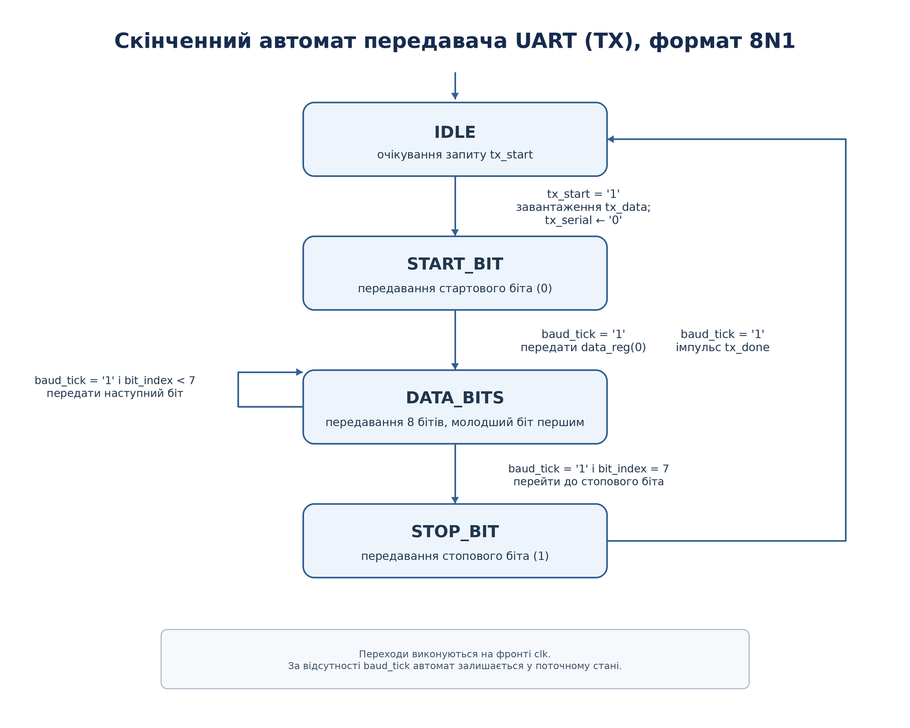
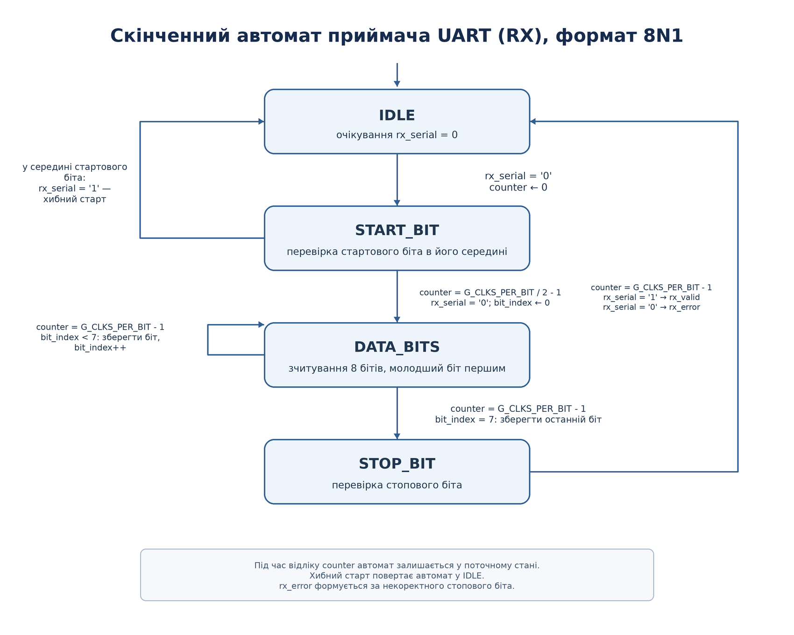

# Діаграми станів UART

Передавач і приймач реалізовано як скінченні автомати з чотирма станами: `IDLE`, `START_BIT`, `DATA_BITS` і `STOP_BIT`. Переходи виконуються на фронті системного сигналу `clk`.

## Передавач (TX)

У `IDLE` передавач очікує `tx_start`. Після запиту байт копіюється до `data_reg`, а на виході встановлюється нуль стартового біта. У `START_BIT` передавач очікує `baud_tick`, після чого видає молодший біт байта та переходить до `DATA_BITS`.

У `DATA_BITS` кожний `baud_tick` перемикає вихід на наступний біт. Після передавання біта з індексом 7 автомат переходить до `STOP_BIT` і встановлює на лінії одиницю. За наступним `baud_tick` формується імпульс `tx_done`, а автомат повертається до `IDLE`.

## Приймач (RX)

У `IDLE` приймач очікує появи нуля на `rx_serial`. Після виявлення стартового біта автомат переходить до `START_BIT` і перевіряє рівень лінії приблизно посередині стартового інтервалу. Якщо рівень дорівнює одиниці, імпульс вважається хибним і автомат повертається до `IDLE`.

Після підтвердження стартового біта автомат переходить до `DATA_BITS`. Значення восьми бітів зчитуються через один повний інтервал `G_CLKS_PER_BIT`, починаючи з молодшого біта. Після зчитування біта з індексом 7 виконується перехід до `STOP_BIT`.

Наприкінці стопового інтервалу перевіряється `rx_serial`. За рівня 1 прийнятий байт записується в `data_out` і формується імпульс `rx_valid`. За рівня 0 формується `rx_error`. Після перевірки автомат повертається до `IDLE`.

У TX зміна стану відбувається за імпульсом `baud_tick`. У RX лічильник `counter` визначає моменти перевірки стартового біта, зчитування інформаційних бітів і перевірки стопового біта.
